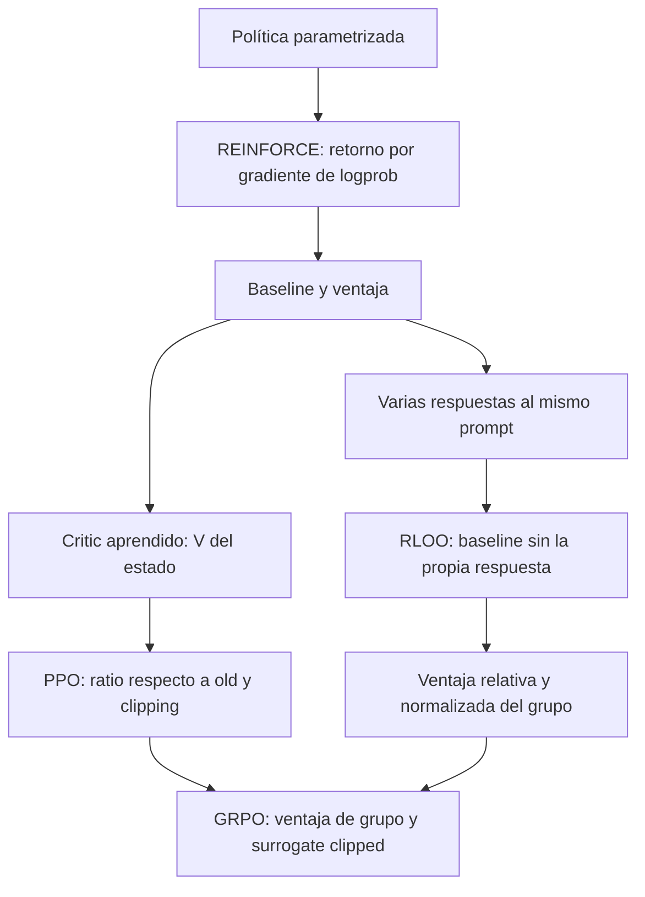

# Camino hacia GRPO

Criterio docente aclarado por Juan: mejorar la progresión del bloque deep RL para que GRPO sea una llegada comprensible. Conservar los fundamentos de la clase y justificar cada pieza antes de ensamblar el algoritmo. El ejemplo de generación de texto permite observar esas piezas; el origen humano o verificable del reward se trata por separado.

## Una pregunta por transición

| Paso | Problema que aparece | Idea que introducimos | Evidencia de comprensión |
|---|---|---|---|
| Política parametrizada | ¿Cómo cambiar decisiones sin guardar una Q-table? | Una distribución de acciones cuyos parámetros aprendemos | Distinguir logits, probabilidades y valores Q |
| Gradiente de política / REINFORCE | La recompensa no tiene por qué ser diferenciable | Multiplicar gradiente de logprob por retorno muestreado | Predecir qué probabilidades aumentan |
| Baseline y ventaja | El retorno muestreado tiene alta variabilidad | Comparar con una expectativa para reducir varianza | Explicar por qué una recompensa positiva puede tener ventaja negativa |
| Actor-critic | ¿Cómo estimar esa expectativa desde cada estado? | Aprender V(s); separar critic de reward model | Identificar quién puntúa y quién predice retorno |
| PPO | Queremos varias actualizaciones con los mismos rollouts | Política vieja, ratio y objetivo clipped | Resolver los cuatro casos de signo/ratio |
| Comparación por prompt / RLOO | ¿Podemos construir una referencia sin entrenar un critic? | Varias respuestas al mismo prompt; promedio de las otras | Calcular leave-one-out y explicar qué excluye |
| GRPO | Combinar ventajas de grupo con actualización conservadora | Ventajas relativas + surrogate clipped; KL según la receta elegida | Reconstruir la loss y explicar cada término |

No enseñar la tabla como una cronología de sustituciones. Para llegar a GRPO convergen dos decisiones: **cómo obtener la ventaja** y **cómo actualizar con los rollouts disponibles**. RLOO sirve de puente para entender grupos; GRPO no conserva exactamente su baseline leave-one-out.

## Mantener un ejemplo durante la explicación

Usar el prompt de ayuda y respuestas candidatas del notebook. Primero puntuar cada respuesta; después construir baseline/ventaja; finalmente cambiar sus probabilidades. No introducir simultáneamente otro modelo, otra tarea y otro reward al cambiar de algoritmo.

**1. Del retorno al gradiente.** Para una política de una sola decisión con tres respuestas, probabilidades [0.25,0.25,0.50] y rewards [0,0,1], el reward esperado es 0.50. Respecto de los logits, su gradiente es p_i·(r_i−J): [−0.125,−0.125,+0.25]. Preguntar por el signo antes de mostrarlo. En una respuesta autoregresiva, logprob de la secuencia es suma de logprobs de acciones.

**2. Del retorno a la ventaja.** Una respuesta con reward 1 y baseline 2 tiene ventaja −1: es peor que la expectativa aunque su reward sea positivo. Un baseline independiente de la acción conserva la justificación del estimador. Detener gradientes no vuelve independiente una cantidad que contiene la propia muestra.

**3. Dos maneras de construir referencia.** El critic estima retorno desde el estado; un grupo proporciona comparación entre resultados del mismo prompt. No comparar scores de preguntas heterogéneas como si fueran intercambiables. RLOO es una construcción de baseline; no requiere critic aprendido. [Fuente: RLOO](https://arxiv.org/abs/2402.14740).

Para un grupo de cuatro rewards [0,0,1,1]:

| Cantidad | Valores |
|---|---|
| Baseline leave-one-out | [2/3,2/3,1/3,1/3] |
| Ventaja RLOO | [−2/3,−2/3,+2/3,+2/3] |
| Media de grupo | 1/2 |
| Desviación poblacional | 1/2 |
| Ventaja normalizada GRPO | [−1,−1,+1,+1] |

Para [1,1,1,1], la ventaja de tarea GRPO es cero. No afirmar que desaparece cualquier actualización: una penalización KL puede seguir actuando.

**4. De un update a reutilizar rollouts.** Al muestrear, current=old y el ratio vale 1. Después de un update, current cambia, pero las logprobs old quedan guardadas. La referencia SFT es otra cantidad: ancla el comportamiento inicial y no es el denominador del ratio PPO. Resolver los cuatro casos del notebook antes de introducir la ecuación completa. [Fuente: PPO](https://arxiv.org/abs/1707.06347).

**5. Ensamblar GRPO.** Ya tenemos las ventajas de grupo y la regla de actualización clipped. En la formulación original usamos, por respuesta, la media de tokens de:

$$-\min\left(\rho_{i,t}A_i,\operatorname{clip}(\rho_{i,t},1-\epsilon,1+\epsilon)A_i\right)+\beta k_{3,i,t}.$$

Aquí $\rho_{i,t}=\exp(\log\pi_\theta-\log\pi_{old})$ y $k_3=\exp(\log\pi_{ref}-\log\pi_\theta)-(\log\pi_{ref}-\log\pi_\theta)-1$. Las logprobs corresponden a la misma acción y prefijo. Excluir prompt/PAD e incluir EOS. La KL en rollouts reutilizados es parte del surrogate, no una medida exacta de toda la distribución actual. [Fuente: DeepSeekMath](https://arxiv.org/abs/2402.03300).

En outcome reward, A_i se comparte entre los tokens de la respuesta. Ese mecanismo no identifica qué palabra individual causó el éxito. Tampoco necesita que el reward provenga de un verificador: puede usar un RM de preferencias.

## Cómo usar el material existente

1. Presentar las slides sobre política y REINFORCE antes de introducir nombres de optimizadores.
2. Detenerse en baseline/ventaja y contrastar critic con comparación entre respuestas.
3. Explicar de PPO lo necesario para GRPO: old/current, ratio, reutilización y clipping. GAE queda como una intuición o lectura; no exige una derivación completa en esta ruta.
4. Calcular RLOO y ventaja GRPO con el mismo grupo; hacer visible la diferencia entre ambas.
5. Ensamblar la loss GRPO con piezas ya vistas y ejecutar el notebook principal.
6. Evaluar sus límites antes de mencionar variantes. DPO/DAPO/Dr. GRPO/GSPO quedan después de la llegada, como lecturas o cierre breve.

La anotación de preferencias y el entrenamiento del RM pueden prepararse antes de clase para dedicar la práctica a ventajas, ratios, máscaras y actualización GRPO. El notebook de mini RLHF conserva la actividad humana para otro momento o para el ensayo. El objetivo original de probar un ajuste en la Orin permanece; el equipo desconectado se retoma después.

## Preguntas de salida

- ¿Qué función cumple un baseline y qué aprende el critic?
- ¿Por qué las respuestas deben compartir prompt al construir el grupo?
- ¿Qué diferencia hay entre la ventaja RLOO y la normalizada GRPO?
- ¿Por qué el ratio usa old mientras la KL usa ref?
- ¿Qué término puede actuar si el grupo tiene rewards idénticos?
- ¿Qué parte cambia si mantenemos GRPO y reemplazamos RM por verificador?

La comprobación principal es que el estudiante pueda reconstruir GRPO y justificar sus términos, además de observar una corrida. Usar IA sigue siendo opcional: exigir el cálculo del grupo y explicación individual del update.
