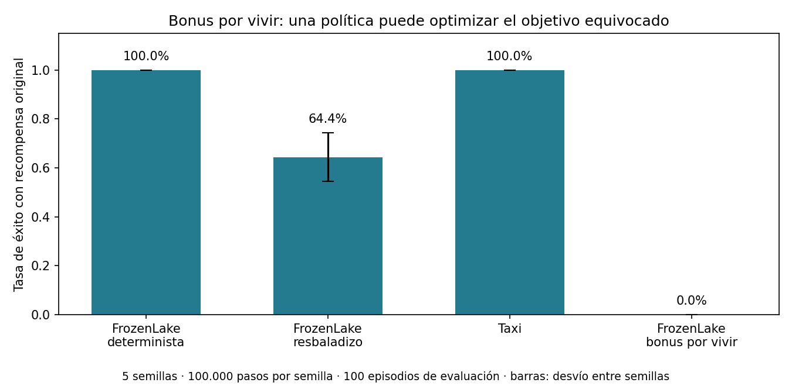
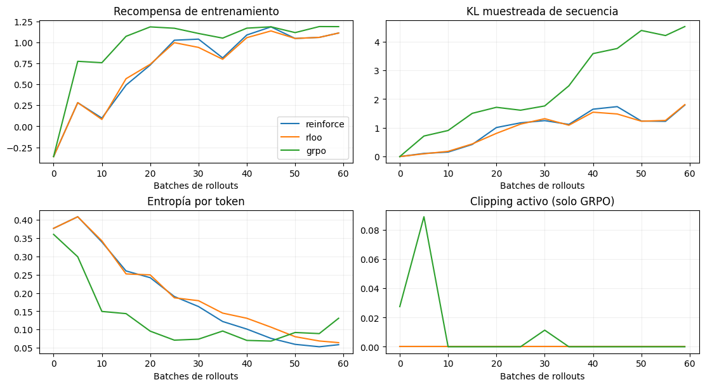

# Evidencia de validación local

12/10/2026. Equipo local macOS, CPU; Python 3.13.3, PyTorch 2.9.0, NumPy 2.3.4, Gymnasium 1.2.1, Matplotlib 3.10.7 e ipykernel 7.1.0. No es un benchmark de Jetson. Se usó el entorno `.venv` existente sin modificar `pyproject.toml` ni instalar paquetes del curso sobre la placa. Las dependencias tabulares coinciden con las versiones usadas; no se ensayó todavía una instalación desde cero en otra máquina.

## Actividad formativa Q-learning (antes propuesta como TP1)

Se ejecutó la solución de referencia con cinco semillas (11,22,33,44,55), 100.000 pasos por configuración/semilla, α=0.3, γ=0.95, ε=0.1+0.9 exp(-6t/presupuesto). Cuatro configuraciones: **2.000.000 de transiciones de entrenamiento** en total. Evaluación greedy con desempate aleatorio, 100 episodios por política y semilla, partición **validation**, sin aprendizaje ni bonus. El test permanece reservado.

| Configuración | Retorno original | Éxito | Pasos por episodio | Truncación |
|---|---:|---:|---:|---:|
| FrozenLake determinista | 1.000 ± 0.000 | 100% | 6.000 ± 0.000 | 0% |
| FrozenLake resbaladizo | 0.644 ± 0.099 | 64.4% | 36.936 ± 5.783 | 3.4% |
| Taxi-v3 | 7.984 ± 0.017 | 100% | 13.016 ± 0.017 | 0% |
| FrozenLake resbaladizo, bonus +0.05 durante train | 0.000 ± 0.000 | 0% | 100.000 ± 0.000 | 100% |

El ± indica desviación de las cinco medias por semilla; no es un intervalo de confianza. Baselines aleatorios de éxito: 1% en FrozenLake determinista, 1.2% en resbaladizo y 4% en Taxi. La aleatoriedad de esos rollouts usa las mismas reset seeds por escenario.



El bonus produjo una política que permanece en el lago sin llegar a la meta. Es evidencia del diseño de recompensa en esta configuración, no una ley sobre cualquier bonus ni un requisito de score para estudiantes.

Resumen durable: [q_learning_local_summary.json](q_learning_local_summary.json). Corrida completa con retornos por episodio y tablas Q: `../actividades/q_learning/outputs/referencia_completa/` (artefactos locales ignorados por Git). Para regenerar desde la raíz:

```bash
.venv/bin/python 2026/docentes/referencia_q_learning.py --steps 100000 --output /tmp/q-learning-2026
```

El notebook inicial de estudiantes tiene un TODO intencional y no debe ejecutar hasta completar Q-learning. Para comprobar su infraestructura se inyectó la actualización de referencia en una copia docente, se completaron contraejemplos y trayectorias y se ejecutó desde kernel nuevo: [q_learning_referencia_ejecutada.ipynb](../docentes/q_learning_referencia_ejecutada.ipynb). Esa corrida usa modo demo (una semilla/3.000 pasos); la tabla anterior corresponde al script completo, no a esa demo.

## Mini modelo de lenguaje

Pipeline completo ejecutado tanto por CLI como por notebook con kernel nuevo: 250 actualizaciones SFT, 200 de reward model y 100 de REINFORCE con β=0.1. Generador **13.923 parámetros**, reward model **1.089**. Datos locales; sin descargas de pesos ni APIs.

| Métrica | Antes de RL | Después |
|---|---:|---:|
| Recompensa proxy normalizada | -0.177 | 1.152 |
| KL de secuencia estimada | ~0 | 1.625 |
| Palabras por respuesta | 4.02 | 2.74 |
| Respuestas con alguna palabra repetida | 35.6% | 1.1% |
| Finalización con EOS | 100% | 100% |

90 muestras por política, una semilla. El entrenamiento del reward model alcanzó 100% de accuracy en seis pares reservados de preferencias **simuladas**. Es un conjunto pequeño con respuestas/contextos compartidos, por lo que ese resultado no demuestra generalización ni satisfacción humana.

Ejemplos con mismo contexto y seed: “vete ahora” → “hola que necesitas”; “nada nada nada nada” → “de nada”. También hay menos diversidad después: discutir colapso, no describirlo automáticamente como mejora.

Tiempo observado del pipeline en notebook: **1.97 s**, después de importar PyTorch. Primera corrida CLI: **6.21 s** dentro del pipeline. Estos tiempos dependen del entorno/cachés y excluyen el arranque/import del intérprete; no se extrapolan a la Nano.

Notebook ejecutado: [mini_rlhf.ipynb](../clase2/mini_rlhf.ipynb). Métricas durables: [rlhf_local_metrics.json](rlhf_local_metrics.json). Checkpoint y pares nuevos: `../clase2/outputs/notebook/` (locales, ignorados por Git); checkpoint medido **123.289 bytes**. El código también guarda la referencia y recompensa para reproducir la evaluación.

**Feedback humano no realizado; Jetson no probada.** El archivo conserva `feedback_source: SIMULATED` y `human_quality_verified: false`. Se incluye etiquetado interactivo y evaluación ciega para completar la actividad con personas.

Actualización de hardware: Juan confirmó Orin Nano de 8 GB. Se localizaron alias y datos de acceso en `home_management`. El intento SSH y las comprobaciones de los servicios documentados agotaron el tiempo de espera, pese a una ruta local a la misma subred. No se abrió una sesión ni se transfirieron archivos al equipo. Las versiones documentadas son JetPack 6 / L4T R36.5.2 / CUDA 12.6, todavía pendientes de verificación remota.

## Nuevo notebook: gradientes de política para generación

[llm_policy_gradients.ipynb](../clase2/llm_policy_gradients.ipynb) ejecutado completo en un kernel CPU nuevo: nueve celdas de código, nueve explicativas. Se entrenó el mismo SFT y RM sintético, luego REINFORCE, RLOO y GRPO desde copias del checkpoint inicial. Cada método consumió 60 batches de tres prompts × ocho respuestas: **1.440 completions por método**. REINFORCE/RLOO: 60 actualizaciones; GRPO: 180. Beta=.1, semilla de ajuste 3030, 180 muestras de evaluación por política con seed 9900.

| Política | Reward proxy | Contrato de formato | KL de secuencia muestreada | Fracción de textos distintos |
|---|---:|---:|---:|---:|
| SFT | −0.195 | 32.2% | ~0 | 8.9% |
| REINFORCE | 1.172 | 100.0% | 1.641 | 2.2% |
| RLOO | 1.163 | 99.4% | 1.620 | 2.8% |
| GRPO | 1.183 | 91.7% | 3.540 | 6.1% |

Resultados de una semilla y tres contextos ya conocidos, sin igualar número de updates. **No demuestran superioridad de un algoritmo ni calidad humana.** La diversidad disminuye y la KL sube; son resultados útiles para interpretar los límites del proxy. La fracción de textos distintos es el número de cadenas únicas dividido por 180, no una métrica general de diversidad.



Se ejecutó además GRPO desde SFT con un verificador de formato: cumplimiento 32.2% → **97.2%**, proxy −0.195 → 1.046, KL 1.294. Dos de tres grupos finales tenían rewards idénticos. El verificador comprueba prefijo, longitud, ausencia de palabras repetidas y EOS; puede aprobar respuestas inútiles. Es RLVR de un contrato, no una prueba de razonamiento. El ajuste y sus métricas se guardaron.

Duración observada del loop de entrenamiento: REINFORCE 0.384 s, RLOO 0.552 s, GRPO 0.753 s en este kernel local, sin contar SFT/RM/imports. No son benchmarks reproducidos ni estimaciones de latencia Orin. Comparar uso de cómputo requiere medir hardware, generación y presupuesto completo.

Se verificaron coincidencia entre logprob al muestrear y teacher forcing, máscaras EOS/PAD, clipping direccional y gradientes en cuatro casos, ventajas RLOO/GRPO, grupos constantes y expectativas k1/k3 con una distribución categórica exacta. Se enumeraron dos acciones Bernoulli para comprobar el baseline leave-one-out. Recargar cada una de las tres políticas reproduce exactamente los textos de evaluación y sus scores. Referencia y checkpoint inicial permanecen intactos; todas las políticas cambian.

Métricas durables: [comparación](policy_gradients_local_metrics.json), [verificador](verifier_local_metrics.json). Checkpoints locales ignorados: `../clase2/outputs/policy_gradients_notebook/`. El protocolo de evaluación ciega para GRPO se guarda en su subcarpeta `blind_grpo/`. Feedback humano y LLM preentrenado siguen pendientes.

**Orin aplazada:** Juan confirmó que está desconectada y pidió dejar el ensayo remoto para después. No se siguen intentando conexiones. El contenido y notebook CPU pueden revisarse mientras tanto.

## Comprobaciones

- Targets Bellman en caso normal, terminal y truncado; máximo frente a índice de máximo.
- Presupuesto exacto de pasos y separación de reset seeds validation/test.
- Evaluación no altera Q; rollout de interpretación respeta límite.
- Plantilla de preferencias balancea orden A/B; lector humano rechaza fuente simulada y pares alterados.
- Muestreo excluye tokens de control, incluye EOS y rellena con PAD después de finalizar.
- KL de modelos iguales es cero; pesos de la política cambian y referencia queda idéntica durante RL.
- Recarga del checkpoint reproduce métricas y las mismas muestras de evaluación.
- Sintaxis de celdas verificada; mini modelo y diagnóstico parsean con gramática Python 3.6. Esto no comprueba compatibilidad de binarios Jetson.
- Notebooks ejecutados en kernels nuevos; gráficos revisados visualmente.

Repetir checks sin reentrenar:

```bash
.venv/bin/python 2026/validacion/verificar_material.py
```

No se ejecutó el trabajo de Decision Transformer, ahora único TP ni se verificaron todos los videos/enlaces secundarios de las slides. El diagnóstico de su evaluación es por inspección de las referencias y de los JSON de test, como detalla la auditoría.

## Reorganización curricular y archivo — 17/10/2026

La rama local activa es `2026`; `2025` conserva el commit `22824ca`. El traslado de 57 archivos se verificó contra los hashes del [manifiesto](../../archive/2025/MANIFIESTO.json), incluido el notebook anterior con los cambios locales de Juan. Se revisaron 82 enlaces locales del material vigente, sin destinos inexistentes. Las configuraciones de Netflix y Goodreads resuelven archivos existentes desde las rutas nuevas.

Las comprobaciones de invariantes de `verificar_material.py` volvieron a pasar después del cambio de rutas: Bellman, presupuesto, evaluación inmutable, particiones, preferencias, EOS, KL, RLOO, clipping, verificador, recarga de checkpoints y sintaxis de notebooks. No se repitieron entrenamientos por cambios de texto. La actividad Q-learning conserva su TODO intencional y ahora señala que el modo completo y la hoja de trabajo son optativos.

El único TP sigue siendo Decision Transformer; su evaluación histórica no se considera corregida ni validada por este traslado. Los guiones introductorios se actualizaron localmente; no se editaron los decks de Drive ni los PDFs históricos.

## Clase 1 en Google Slides — 17/10/2026

Se editó la copia 2026 y se exportó a [PDF](../clase1/Clase_1_2026.pdf). El deck pasa de 94 a 87 slides: dos slides de RL en LLMs sustituyen el bloque histórico. Se revisaron portada, agenda, transición, fuentes, notas, noción online/offline, preferencias y cierre de actividades. Se compararon las 78 slides visualmente conservadas y sus píxeles coinciden con el origen. El checker de contenido no reportó incidencias. La revisión visual se completó con dos correcciones de contraste del enlace final, incluida la última letra. [Registro](clase1_revision.json).

El [guion de ensayo](../clase1/GUIA_PRESENTACION.md) reserva 6–8 minutos al anticipo de RL en LLMs; no se afirma haber realizado un ensayo oral con Juan. Clase 2 y el protocolo definitivo del único TP siguen pendientes. Los originales 2025 se conservaron.

## Bloque de ética y presentación del TP — 18/10/2026

Clase 1 mantiene 87 páginas. Se revisaron todas las páginas exportadas y las ocho modificadas en detalle; 79 páginas conservan exactamente sus píxeles frente al deck leído al iniciar esta edición. El checker no reportó incidencias. Las slides 80–86 incluyen cuatro casos, una actividad de preferencias y un cierre; siete enlaces apuntan a fuentes primarias. No se requirieron correcciones tras la revisión visual.

Se comprobó el orden, el uso de texto y bullets nativos y la ausencia de TP/Decision Transformer en el texto visible de Clase 1. La agenda y el cierre ya no lo anuncian en sus notas. El plan reserva su presentación al encuentro 4. El PDF se reemplazó por esta exportación. [Registro](clase1_etica_revision.json). La duración de 28 minutos es una propuesta pendiente de ensayo oral; no se reentrenaron modelos por cambios de contenido.

### Revisión de los casos Navier–Stokes y ciberseguridad — 18/10/2026

Se verificó la redacción aprobada en las slides 81 y 83, sus bullets nativos y seis enlaces a fuentes. Navier–Stokes incorpora prioridades de investigación; ciberseguridad usa OpenAI–Hugging Face 2026 y distingue entrenamiento previo y evaluación. El deck conserva 87 páginas, orden y ausencia del TP en el texto visible. Se revisaron todas las páginas de la exportación final; 85 conservan sus objetos y propiedades nativos. La imagen de la página 46 varió entre exportaciones sin cambios en sus objetos nativos; fue revisada visualmente.

El checker previo no reportó incidencias. Una pasada de corrección resolvió la superposición del título de ciberseguridad (24 pt, cuerpo 18 pt) y el contraste de las fuentes nuevas. El PDF y el [registro](clase1_etica_revision.json) corresponden a esta revisión. Se verifican enlaces locales y consistencia documental; no se repiten entrenamientos por cambios de texto.
